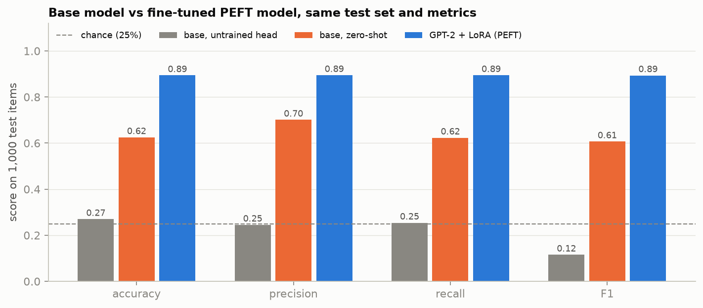
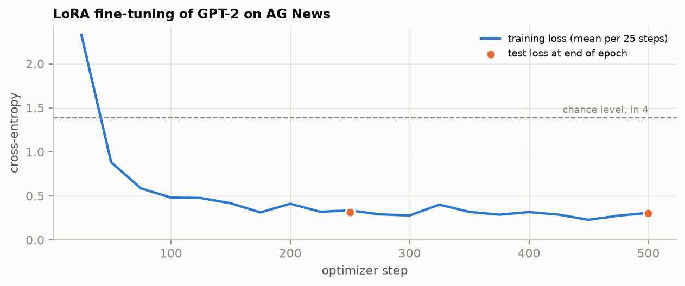
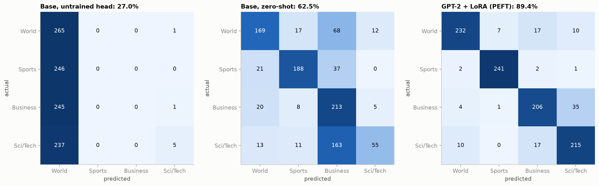
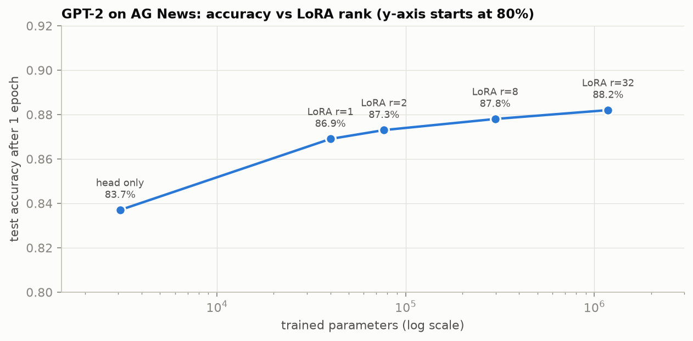

# Lightweight fine-tuning of GPT-2 with LoRA

Turning GPT-2, a 124M-parameter text generator, into a four-class news topic classifier by training **0.24% of its weights** with LoRA through the Hugging Face [`peft`](https://huggingface.co/docs/peft) library.

| Model | Accuracy | Precision | Recall | F1 | Trained parameters |
|---|---:|---:|---:|---:|---:|
| Base GPT-2, as downloaded (untrained classification head) | 27.0% | 0.245 | 0.254 | 0.115 | 0 |
| Base GPT-2, zero-shot (no added layer) | 62.5% | 0.701 | 0.623 | 0.607 | 0 |
| **GPT-2 + LoRA, loaded with `AutoPeftModelForSequenceClassification`** | **89.4%** | **0.895** | **0.894** | **0.894** | **297,984** |

All three rows are measured on the same 1,000 held-out AG News items with the same `Trainer.evaluate()` settings and metrics (precision, recall and F1 are macro-averaged over the four classes). The fine-tuned row is the adapter **loaded back from disk**, and it reproduces the trained model's predictions exactly.



## What is in this repository

```
LightweightFineTuning.ipynb     the notebook, organized as Sections 1-8 following the project rubric
gpt2-lora-ag-news/              the saved PEFT model
  adapter_config.json           LoRA settings and the base model it applies to
  adapter_model.safetensors     the trained LoRA adapters + classification head (1.14 MB)
  tokenizer.json, tokenizer_config.json
assets/                         figures used in this README
requirements.txt
```

## How to run it

**Locally** (tested with Python 3.13 on an Apple Silicon Mac; any machine with a recent PyTorch works):

```bash
python3 -m venv .venv
source .venv/bin/activate
pip install -r requirements.txt
jupyter lab LightweightFineTuning.ipynb
```

Then run all cells. The whole notebook takes about seven minutes on a laptop GPU: under two minutes for the required fine-tuning, and the rest for the optional experiments at the end. GPT-2 and AG News download from the Hugging Face Hub on first use.

**In the course workspace**, open the notebook and run all cells. The code adapts to older library versions on its own (the three places are marked "Compatibility 1/2/3 of 3"). The QLoRA cells need a CUDA or Apple Silicon GPU and skip themselves otherwise.

**Just the saved model**, without re-training:

```python
from peft import AutoPeftModelForSequenceClassification
from transformers import AutoTokenizer

labels = ["World", "Sports", "Business", "Sci/Tech"]
model = AutoPeftModelForSequenceClassification.from_pretrained("gpt2-lora-ag-news", num_labels=4)
model.config.pad_token_id = model.config.eos_token_id   # GPT-2 needs this to find the last real token
tokenizer = AutoTokenizer.from_pretrained("gpt2-lora-ag-news")

inputs = tokenizer("Striker scores twice in stoppage time to win the final", return_tensors="pt")
print(labels[model(**inputs).logits.argmax(-1).item()])   # Sports
```

## How the notebook follows the rubric

| Rubric item | Section | What it does |
|---|---|---|
| Load a pretrained HF model | 1 | `openai-community/gpt2` with `AutoModelForSequenceClassification` (4 labels) |
| Load and preprocess a dataset | 2 | [AG News](https://huggingface.co/datasets/fancyzhx/ag_news): 4,000 train / 1,000 test items, GPT-2's `AutoTokenizer`, padding with `DataCollatorWithPadding` |
| Evaluate the pretrained model | 3 | The base model **as-is** (no training) with `Trainer.evaluate()`: accuracy, precision, recall, F1. Plus a zero-shot evaluation of the unmodified language model |
| Create a PEFT model | 4 | `LoraConfig(task_type=SEQ_CLS, r=8, lora_alpha=16, lora_dropout=0.1, target_modules=["c_attn"], fan_in_fan_out=True)` + `get_peft_model` |
| Train the PEFT model | 5 | 2 epochs with `Trainer`, learning rate 5e-4, batch size 16 |
| Save the PEFT model | 6 | `save_pretrained("gpt2-lora-ag-news")`, in the same folder as the notebook |
| Load the saved PEFT model | 7 | `AutoPeftModelForSequenceClassification.from_pretrained("gpt2-lora-ag-news", ...)` |
| Evaluate the fine-tuned model | 8 | The same `Trainer.evaluate()` as Section 3, a side-by-side table and chart, confusion matrices, per-class recall, a paired significance test, and example predictions |

## Approach

LoRA keeps every original weight $W_0$ frozen and learns a small update next to it, $W_0 + \frac{\alpha}{r}BA$, where $A$ has $r$ rows and $B$ has $r$ columns. Where the 297,984 trained parameters come from, step by step:


| Step | Calculation | Result |
|---|---|---:|
| `c_attn` (query, key, value together) maps 768 to | $3 \times 768$ | 2,304 |
| $A$: $r$ rows × 768 columns | $8 \times 768$ | 6,144 |
| $B$: 2,304 rows × $r$ columns | $2304 \times 8$ | 18,432 |
| One layer's adapter, $A + B$ | $6{,}144 + 18{,}432$ | 24,576 |
| All 12 layers | $12 \times 24{,}576$ | 294,912 |
| Classification head (4 classes, no bias) | $4 \times 768$ | 3,072 |
| **Total trained** | $294{,}912 + 3{,}072$ | **297,984** |
| Share of GPT-2 | $297{,}984 \;/\; 124{,}442{,}880$ | 0.24% |

Two GPT-2 details the notebook handles explicitly: GPT-2 has no padding token, so the end-of-text token is used and `pad_token_id` is set on the model (also after reloading); and GPT-2 stores attention weights transposed, so LoRA needs `fan_in_fan_out=True`.



## Results

**Base model vs fine-tuned model.** Accuracy rises from 27.0% to 89.4%. The base model with its untrained head answers "World" for 993 of 1,000 items; used zero-shot, the pretrained model reaches 62.5% but rarely recognizes Sci/Tech. After fine-tuning every class improves, Sports is nearly solved (98% recall), and most remaining errors are Business stories labelled Sci/Tech, where technology-company news genuinely belongs to both.



On the items where the fine-tuned and base models disagree, the fine-tuned model is right 659 times to 35 (exact McNemar p ≈ 3 × 10⁻¹⁵⁰), and 311 times to 42 against the zero-shot baseline.

**Comparing PEFT configurations.** Five configurations trained for one epoch each under identical settings:



| Configuration | Trained parameters | Accuracy after 1 epoch |
|---|---:|---:|
| Head only (GPT-2 frozen) | 3,072 | 83.7% |
| LoRA r = 1 | 39,936 | 86.9% |
| LoRA r = 2 | 76,800 | 87.3% |
| LoRA r = 8 | 297,984 | 87.8% |
| LoRA r = 32 | 1,182,720 | 88.2% |

The frozen features already separate topics well (83.7% with only the head trained), the first LoRA rank adds 3.2 points, and going from rank 1 to rank 32 adds only 1.3 more. Training time is the same for every rank: the cost is the backward pass through the network, not the adapter size.

**QLoRA.** The same rank-8 adapter trained on GPT-2 quantized to 4-bit NF4 with `bitsandbytes`, on the laptop's Apple Silicon GPU:

| | LoRA r=8 | QLoRA r=8 |
|---|---:|---:|
| Frozen base weights stored as | 32-bit | 4-bit NF4 |
| Model in memory | 474.7 MB | **191.2 MB** |
| Accuracy after 1 epoch | 87.8% | 88.9% |

The 191.2 MB is 84,934,656 linear-layer weights at half a byte each (40.5 MB) plus 39,508,224 parameters kept in 32-bit (150.7 MB). The saving is 2.5x rather than 8x because QLoRA only quantizes linear layers and GPT-2's embeddings are 32% of the model. Quantization cost nothing measurable in accuracy.

None of the one-epoch experiments beats the submitted two-epoch model (89.4%).

## Limitations

- The untrained-head baseline is a floor, not a competitor. The zero-shot and head-only results are fairer reference points, and the fine-tuned model beats both.
- One seed and a 4,000-item training subset. More data would raise every number.
- The test set is also used to report per-epoch metrics during training (no model selection is done on it).

## References

- Hu et al. (2021). *LoRA: Low-Rank Adaptation of Large Language Models.* [arXiv:2106.09685](https://arxiv.org/abs/2106.09685)
- Dettmers, Pagnoni, Holtzman & Zettlemoyer (2023). *QLoRA: Efficient Finetuning of Quantized LLMs.* [arXiv:2305.14314](https://arxiv.org/abs/2305.14314)
- Aghajanyan, Zettlemoyer & Gupta (2020). *Intrinsic Dimensionality Explains the Effectiveness of Language Model Fine-Tuning.* [arXiv:2012.13255](https://arxiv.org/abs/2012.13255)
- Hugging Face PEFT: [LoRA](https://huggingface.co/docs/peft/package_reference/lora), [AutoPeftModel](https://huggingface.co/docs/peft/package_reference/auto_class)
- Dataset: [fancyzhx/ag_news](https://huggingface.co/datasets/fancyzhx/ag_news)
